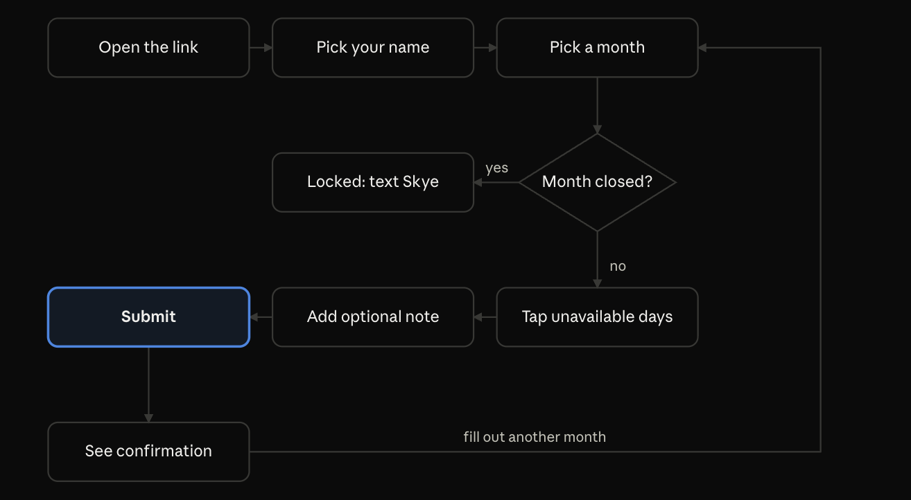

# Heritage Media Availability Form — Spec

Sep 26, 2026 · @Skye Brown

## Overview

The Heritage Media Availability Form is a mobile-friendly web form where Heritage media team members submit the days they're unavailable each month, and Skye sees every response in one place. It replaces the monthly group-chat text and the manual copy into the Google Doc scheduling template.

**Today:** Near the end of each month, Skye texts the group chat asking for next month's unavailable dates. Replies arrive scattered across the thread and get retyped by hand into the template.

**Goal:** Collect availability in one structured place, show who has and hasn't responded, and produce text that pastes straight into the template.

**Success for v1:** Team members can submit the form and Skye can view the responses. Getting about 90% of availability through the form instead of texts counts as a win; last-minute changes after a month closes can still come by text.

## Users and roles

Two roles: team members submit, and Skye collects. The team side needs no login, so it stays as simple as possible for less tech-comfortable volunteers.

| Role        | Who                                                                              | How they get in                                   | What they can do                                                                                      |
| ----------- | -------------------------------------------------------------------------------- | ------------------------------------------------- | ----------------------------------------------------------------------------------------------------- |
| Team member | Fewer than 20 media volunteers, mostly on phones, many not comfortable with tech | One shared link; picks their name from a dropdown | Submit or resubmit unavailable days for any open month, up to 6 months ahead                          |
| Admin       | Skye only                                                                        | Password-protected admin page                     | Manage the roster, track responses, view by date and by person, copy results, close and reopen months |

## Scope

v1 covers collecting and viewing whole-day availability. Anything that assigns people to serve is out of scope.

### In v1

- One shareable link, mobile-first design
- Name dropdown of active roster members
- Month picker covering the current month through 6 months ahead; one submission covers one person and one month
- Tap-to-select calendar of every day in the month
- "Available all month" and "Unavailable all month" options
- Optional notes field
- Resubmission, where the latest submission wins
- Admin: password login, simple roster (name + active), response tracker, by-date and by-person views with copy buttons, close and reopen months

### Later

- Phone-number login
- Notifications and reminders, including alerts to Skye about changes
- Recurring availability rules (e.g. only 3rd Sundays, never weekday nights)
- Advanced reporting and export
- Time-of-day or service-level availability
- Fitting into the larger volunteer scheduling app

### Non-goals

- Scheduling. The app only collects and displays availability; it never assigns people to dates.
- Roles or positions on the roster. Those belong to the scheduling side.

## Functional requirements

IDs let you reference each requirement when prompting an AI coding tool or testing the pilot. Build status for each requirement lives in GitHub Issues, not here.

### Team form

| ID | Requirement |
| --- | --- |
| TF-1 | The form lives at one public link with no account or password. |
| TF-2 | The user picks their name from a dropdown of active roster members, shown as "First Last" and sorted A–Z by first name (then last name). |
| TF-3 | The user picks a month from the current month through 6 months ahead. No month is preselected, so the user always picks one deliberately. Closed months show a "(closed)" label. Past months are never offered, even if reopened. |
| TF-4 | Picking a closed month hides the form and shows: "This month's schedule is finalized. Please text Skye with any changes." with a hint underneath: "You can choose a different month above." |
| TF-5 | An open month shows a calendar of every day in that month. Tapping a day toggles it unavailable. |
| TF-6 | Above the calendar, three choice cards offer "Pick specific days" (chosen by default), "I'm available all month", and "I'm unavailable all month". All three stay visible, and the chosen one is marked by an outline and a check, not color alone. Choosing either all-month option clears and hides the calendar and shows, in its place, "You're available all of November." (green, with a check) or "You're unavailable all of November." (rose, with a cross), followed by "No days to pick." Switching back to "Pick specific days" brings the calendar back, cleared. |
| TF-7 | An optional notes field accepts up to 500 characters. |
| TF-8 | Submit requires a name, a month, and either at least one day or an all-month option. Missing pieces get a plain-language message. |
| TF-9 | If the person already submitted for that month, the form pre-fills with it: the calendar days (or all-month choice) and notes start from the earlier submission, so they only change what's different. A read-only summary of that earlier submission stays visible above the calendar as a reference while they edit: a small "Your last answer" label, the answer in bold ("Nov 3-7, 20", "Available all month" or "Unavailable all month"), then "Submitting again replaces it." |
| TF-10 | After submitting, a confirmation restates what was saved, greeting by first name, with a button to fill out another month. Days name the month once, then list ranges: "Thanks, Bob! You're unavailable Oct 3-7, and 20." (one range: "Oct 3-7"; three or more: "Oct 3-7, 10, and 20"). All-month choices read "Thanks, Bob! You're available all of November." and "Thanks, Bob! You're unavailable all of November." |
| TF-11 | The browser remembers the name from its last successful submit, for a year, so returning users find their name already selected. Only active members are preselected; otherwise the dropdown starts empty. Picking a different name and submitting remembers that one instead. Nothing is remembered if the browser blocks cookies. |
| TF-12 | If the chosen name has a standing availability note (AD-2), a reminder appears under the name: a small "Your standing availability" label, the note in bold ("3rd Sundays only"), then "You only need to fill this out if that won't work this month." It also appears for a preselected name (TF-11). Submitting still works normally. |

### Admin

| ID | Requirement |
| --- | --- |
| AD-1 | The admin area sits at a separate path behind Django's admin login (one superuser account, Skye). The login lasts about 30 days per device. |
| AD-2 | Roster: add a person (first and last name, both required), edit their name, toggle active or inactive, and give them an optional standing availability note (up to 100 characters, e.g. "3rd Sundays only") if they serve on a fixed pattern and don't need to respond each month. The note is shown to them on the team form (TF-12). The first + last name pair is unique regardless of capitalization. Inactive people leave the dropdown and tracker, but their past submissions stay. No hard delete in v1. |
| AD-3 | A month selector covers past months (read-only reference) through 6 months ahead. Past months are offered if they have any submission or were ever closed. The dashboard opens on next month, the one usually being collected. |
| AD-4 | The response tracker lists every active member as Responded or Not responded, with the last-submitted time and a count like "12 of 17 responded." A member with a standing availability note who hasn't responded shows as Standing, with their note, instead of Not responded; they're left out of the count and shown beside it ("12 of 15 responded · 2 standing"). Once they respond, they're counted like anyone else. Members added to the roster after a month ended aren't listed for it, unless they submitted for it. Inactive members who submitted for the month appear in a separate "No longer active" section at the bottom, by full name, with their answer and notes; they're left out of the count and all copy text. |
| AD-5 | The by-person view lists each member's unavailable days in compact ranges, any all-month choice, and their notes (on a line under the answer). It uses the same order as the by-person copy text: responders A–Z, then standing members who haven't responded A–Z, then non-responders A–Z. Anyone with a standing note has it shown on its own line, marked with a repeat icon and styled apart from their notes: alone if they haven't responded, or under their answer if they have, so a partial overlap is easy to spot. (Only the copy text puts the note in parentheses.) |
| AD-6 | The by-date view lists each day of the month that has anyone unavailable, with who's out. Days with nobody out are skipped, matching the copy text below. People marked "unavailable all month" are not repeated on each day; they're listed once in a note at the top of the view. On screen, each day also shows its weekday for context ("Fri 4"); the copy text doesn't. When nobody is out, the view says "No responses yet." if no one has responded, or "Nobody is unavailable this month (3 of 7 responded)." if everyone who has responded is available all month, and there's no copy text. |
| AD-7 | The by-person and by-date views each have a copy button that copies their text format below to the clipboard, as plain text. The button briefly reads "Copied!", announced to screen readers. If the browser blocks copying, the text is selected instead, with the message "Couldn't copy automatically. The text is selected, so use your device's Copy command." There's no button when there's nothing to copy. |
| AD-8 | Skye closes and reopens months in the admin, on a Months page and on the dashboard. The Months page lists this month through 6 months ahead, then the 6 months before (past months included); each month shows Open or Closed, its response count ("5 of 6"), and a Close or Reopen button. The dashboard shows the selected month's Open or Closed status with a Close month or Reopen month button. Both happen at once, with no confirmation step, since each is undone with one click; each shows a message ("Closed November 2026.") and are recorded in the month's History. Nothing closes automatically; Skye closes months by hand. |

### Names in admin views and copy output

The tracker, by-person and by-date views, and both copy formats show each person's **display name**: their first name only, plus their last initial when another active member listed for that month shares that first name (ignoring capitalization), e.g. "Bob J." and "Bob S.". If two of them also share a last initial (Bob Jones and Bob Johnson), those two show their full last name instead. Lists are sorted A–Z by first name, then last name. The "No longer active" section uses full names ("Bob Smith"), since it's never part of copy text.

### Copy formats

**By person:** one line per active member, by display name. Responders come first, A–Z by first name, then members with a standing availability note who haven't responded (their note in parentheses), then the other non-responders, each group A–Z by first name. A standing member who has responded shows only their answer. Consecutive days collapse into ranges, and "NA" means available all month.

```
Bob: 3-7, 20
Emily: 13
Jane: 1, 4, 10-11, 27-31
Jim: NA
Sam: unavailable all month
Grace: (3rd Sundays only)
Tom: no response
```

**By date:** one line per day that has anyone out, in date order with display names A–Z by first name. Days with nobody out are skipped. People unavailable all month appear once on the first line instead of on every day; if nobody is, that line is left out entirely. The start of the output for the same responses:

```
Unavailable all month: Sam
1: Jane
3: Bob
4: Bob, Jane
5: Bob
```

## Key user flows

### Team member submits



A closed month stops the flow with a text-Skye message. On an open month, choosing "available all month" or "unavailable all month" replaces tapping days, and any earlier submission for that month is pre-filled.

### Skye's monthly cycle

1. Before building a schedule, open that month's tracker and see who hasn't responded.
2. Text anyone missing directly, since v1 has no notifications.
3. Tap Copy on the by-person and by-date views and paste each into the Google Doc template.
4. Finalize the schedule, then close the month. Changes after that come by text.
5. If a month was closed by mistake, reopen it.

Roster upkeep happens as needed: add new volunteers and mark people inactive when they step away.

## Business rules

These rules must hold on the server, not just in the form, so a stale browser tab can't break them.

- **One current submission per person per month.** A new submission replaces the old one everywhere Skye looks. Every earlier version stays in the database with its timestamp, for checking "I know I marked the 14th."
- **Months are open by default.** There's no step to open a month. The team can submit for the current month through 6 months ahead.
- **Closing locks a month completely.** The server rejects submissions for a closed month, even from a form that was already open. Reopening restores normal submissions. A closed month is the only reason the server rejects a month. Past months should normally be closed, but Skye does that by hand, which leaves room for exceptions.
- **All-month options are exclusive.** A submission is exactly one of: specific days, available all month, or unavailable all month.
- **Any submission counts as a response.** That includes "available all month."
- **Whole days only.** Dates are calendar days with no times, and month boundaries use Eastern time.
- **Identity is trusted.** Anyone with the link could pick any name. That's acceptable in v1 because the data is only names and dates, and the stored history makes mistakes easy to spot.
- **Inactive people are hidden, not deleted.** They leave the dropdown, tracker, and copy output, but their history stays.

## Data model

Three tables cover v1. Keeping every submission, and reading the newest per person and month, gives "last submission wins" plus history for free.

### members

| Field        | Type      | Notes                                                                                   |
| ------------ | --------- | --------------------------------------------------------------------------------------- |
| id           | integer   | Primary key                                                                             |
| first\_name  | text      | Required                                                                                |
| last\_name   | text      | Required. The (first\_name, last\_name) pair is unique regardless of capitalization ("bob smith" = "Bob Smith") |
| is\_active   | boolean   | Default true                                                                            |
| standing\_availability | text | Optional, up to 100 characters, e.g. "3rd Sundays only". Empty for most people        |
| created\_at  | timestamp |                                                                                         |

### submissions

| Field          | Type                                   | Notes                                                          |
| -------------- | -------------------------------------- | -------------------------------------------------------------- |
| id             | integer                                | Primary key                                                    |
| member\_id     | integer                                | Links to members                                               |
| month          | text, YYYY-MM                          | e.g. 2026-11                                                   |
| kind           | text                                   | `days`, `available_all`, or `unavailable_all`                  |
| days           | list of integers (Postgres `ArrayField`) | Day numbers, e.g. `[3, 4, 5, 20]`; empty unless kind is `days` |
| notes          | text                                   | Optional, up to 500 characters                                 |
| submitted\_at  | timestamp                              | The newest per member and month is the current one             |

### closed\_months

| Field       | Type          | Notes                                             |
| ----------- | ------------- | ------------------------------------------------- |
| month       | text, YYYY-MM | Primary key; a row here means the month is closed |
| closed\_at  | timestamp     |                                                   |

Reopening a month deletes its row. The admin login is a Django superuser account (Skye), stored in Django's built-in user table with a hashed password.

The model leaves room for later ideas without rework. Phone login adds a phone column to members, and recurring rules would be a new table linked to members.

## Non-functional requirements

The bar is "easy on an older volunteer's phone," cheap to run, and safe enough for names and dates.

- **Mobile first.** Design at 375 px wide first, and test on iPhone Safari and Android Chrome. The team pages use 16 px text at every width (it also stops iPhone Safari zooming into inputs), with Tailwind Plus control sizes. The admin keeps Unfold's own sizes. Contrast meets WCAG AA.
- **Plain language.** Labels read like a person talking ("Which days can't you serve?"), with no jargon and one decision per screen section.
- **Accessible.** Every input has a label, and calendar days work with a keyboard and screen reader.
- **Look and feel.** Built from Tailwind Plus Application UI blocks: clean cards, generous white space, Tailwind's gray palette, and its default indigo accent.
- **Fast.** Pages load in under 2 seconds on mobile data, and the form never "wakes up" slowly after sitting idle.
- **Secure enough.** HTTPS everywhere, the admin password stored hashed by Django (never in code), and input validated on the server.
- **Cost.** $10 a month or less, ideally near $0.
- **Backups.** The database is backed up at least weekly, by the host or a simple export.

## Technical approach

Recommendation: one Django app with server-rendered pages and Postgres, hosted on Railway's Hobby plan for about $5 a month. It's one codebase, one deploy, and no separate frontend, which keeps the project small enough to finish in a month.

| Layer             | Choice                            | Why                                                                                                                             |
| ----------------- | --------------------------------- | ------------------------------------------------------------------------------------------------------------------------------- |
| Backend           | Django (Python), admin styled with django-unfold | The built-in admin handles the roster and closed months with almost no code, and built-in login protects the admin pages; Unfold gives it a modern look in the app's colors |
| Pages | Django templates + Tailwind (pre-built CSS) and Tailwind Plus blocks | Server-rendered HTML is fast on phones and simple to vibe-code; pre-built CSS avoids building styles on every phone |
| Calendar and copy | Small vanilla JS, or Alpine.js    | Day toggles and the clipboard copy don't need a framework                                                                       |
| Database          | Postgres on Railway               | Managed, backed up, one click to add                                                                                            |
| Hosting           | Railway Hobby                     | $5/month including $5 of usage, which a 20-person form won't exceed ([Railway pricing](https://docs.railway.com/pricing/plans)) |

Django's admin login uses a username and password rather than a bare password, which still meets AD-1. Skye's dashboard (tracker, by-date, by-person, copy) is the admin home page, built from django-unfold's components, so it sits behind that same login.

**All-JavaScript alternative:** Next.js on Vercel with a hosted Postgres free tier. It can run near $0, but you'd build the admin login, roster screens, and month controls yourself.

**Avoid** free hosting tiers that sleep when idle. A volunteer opening the link once a month would wait through a slow wake-up and may assume it's broken.

## Timeline, pilot, and open questions

The form launches October 25, the day November availability requests normally go out.

Three build weeks and a pilot week before launch (2026):

| Week | Dates | Focus |
| --- | --- | --- |
| 1 | Sep 28 – Oct 4 | Setup, roster, deploy |
| 2 | Oct 5 – Oct 11 | Build the team form |
| 3 | Oct 12 – Oct 18 | Build admin views |
| 4 | Oct 19 – Oct 24 | Pilot on staging: a tech-comfortable member, then the lead |
| Launch | Oct 25 | Launch to full team |

Week 1 gets a bare app deployed early, so hosting surprises show up before the real features exist. Each later week ends with something usable.

### Pilot plan

The pilot runs on the staging site, a separate copy of the app with its own database and a "Test site" banner, refreshed with a copy of production's roster and answers, so testers can try anything without touching real data. The launch uses production. [PILOT.md](PILOT.md) has the step-by-step runbook: what each tester does, what to ask them, and Skye's checklist.

1. **Round 1:** one younger, tech-comfortable member submits for November and December on their phone, resubmits once, and tries to break it. Goal: find bugs and confusing spots early.
2. **Round 2:** the media team lead fills out the form, then Skye walks him through her side (dashboard, copy buttons into the Google Doc, closing a month). Goal: agree this is how the team collects availability going forward.
3. Fix what comes up, then share the production link with the full team in the group chat on October 25.
4. After launch, problems found on production become new issues.

### Open questions

None for v1. Copy labels, non-responders, the by-date copy button, the launch date, the app name, and the accent color are settled in the sections above.

## Decisions

Spec decisions that aren't captured in a requirement above, with the date they were made. Decisions that change a requirement are made by editing that requirement directly.

- 2026-09-28: TF-9 pre-fill loads the earlier submission with a small JavaScript fetch, so picking a name and month doesn't reload the page.
- 2026-10-01: If someone is marked inactive while their form is open, their submission is still accepted. The name dropdown shows active members only, but the server accepts any member on the roster.
- 2026-10-03: The app only stores whether someone is active *now*, so a past month can't know who was active then. Rather than add a table tracking when people became inactive (only works going forward), the dashboard lists today's active members minus anyone added after the month ended, plus a "No longer active" section for inactive members who responded to that month (AD-4). Accepted gap: an inactive member who didn't respond to a past month isn't shown as "Not responded".
- 2026-10-09: Pages are built from Skye's licensed Tailwind Plus Application UI blocks (HTML version), and the design rules follow Tailwind Plus defaults with no exceptions: its text and control sizes, its gray palette, and its default indigo accent. This replaces the earlier "16 px minimum, 44 px tap targets, pastel blue accent" rules; WCAG AA (including its 24 px target size) is still met. Tailwind is pre-built into a committed CSS file, not built on Railway, and dark mode is off for now. The pages catch up to these rules in the restyling issues (#40, #41, #36, #14); until then they keep the pastel accent.
- 2026-10-09: The admin uses django-unfold (#39) instead of Django's stock look, so every admin screen shares one modern style: Tailwind's gray with the indigo accent (the same values as the team form), light mode only, and a sidebar with Availability, Roster, Closed months, and Submission history. The availability dashboard is rebuilt from Unfold's own components as the admin home page (#40), replacing the custom-page approach tried in #34. The team form stays on our own Tailwind build, since Unfold only styles logged-in admin pages. Admin pages only need to work on phones, not be designed for them.
- 2026-10-09: On the dashboard (#40), logging in lands straight on the month's responses; the old `/admin/availability/` link forwards there, keeping the chosen month. By person and By date sit side by side on wide screens, with "No longer active" under By person (people on the left, dates on the right) so the columns stay closer in length. Each view's copy text starts collapsed behind "Show copy text"; the Copy button works without opening it. The "Unavailable all month" note in By date is a soft amber callout so it isn't missed. Unfold's Recent actions panel is dropped from the home page; each record's History page keeps those details.
- 2026-10-10: On the Months page (#43), past months start collapsed behind "Show past months", since closing usually happens for this month and ahead. Each month's name links to its dashboard, to check responses before closing. Months older than 6 back show only their Open or Closed status on the dashboard, with no button. The sidebar's "Closed months" becomes "Months". Closing no longer asks for confirmation, unlike the earlier version of AD-8: closing and reopening are each one click, so a mistake is quick to undo.
- 2026-10-10: On the roster (#42), each person shows an Active or Inactive badge and a one-click Deactivate / Activate button that applies at once (recorded in their History), replacing the checkboxes that waited for Save. The edit page's Active checkbox still works. The name opens the edit page. All / Active / Inactive tabs (with counts) sit beside the roster's search box, and a month dropdown beside the submission history's.
- 2026-10-10: Testing happens on a staging site on Railway (#45): the same code as production, deployed from `main`, with its own database and a "Test site" banner on every page, so testers' practice entries never reach production. The pilot runs there; the launch uses production. There's no separate staging branch.
- 2026-10-11: Staging can be refreshed with a copy of production's members, submissions and closed months (not admin logins or History), so testers see the real roster. Copying only ever runs toward staging (or a local database), never into production. Previewing unmerged changes on staging is not set up for now.
- 2026-10-11: Some members serve on a fixed pattern (e.g. only 3rd Sundays), so Skye doesn't need a response from them each month (#46). A standing availability note on the roster marks them: when they haven't responded, the dashboard shows the note instead of "Not responded", leaves them out of the count but shows how many ("· 2 standing"), and lists them between responders and non-responders in By person, with the note in parentheses in the copy text. When they do respond, their note stays visible on screen (not in copy text) in case their answer only partly overlaps it. The team form reminds them (TF-12). The app doesn't work out dates from the note; recurring rules stay a Later item. Like active status, only the current note is stored, so it also applies when looking back at past months.
- 2026-10-12: The team pages now use the design rules (#41): Tailwind Plus's basic card, page heading, native select menus, textarea, alerts and primary button, in Tailwind's gray and indigo; the pastel accent is gone. Text is 16 px at every width, not Tailwind Plus's 14 px from 640 px up, which read too small on a laptop for this team; this is the one exception to "Tailwind Plus defaults, no exceptions". The blue info boxes are the exception to that: a 12 px label, a 16 px value and 14 px explanation, so they stay compact next to the form. The calendar follows Tailwind Plus's small calendar: days in a joined grid, and a chosen day becomes a solid indigo circle with a bold white number (the old ✓ is dropped, since the fill and shape change already show it without relying on color). Each message has its own alert color: closed month in yellow, form errors in red, the thanks sentence in green, and the "Your last answer" summary in blue. It and the standing reminder share a stat-card layout, a small uppercase label just above the value in bold, so the value is what's read first; they differ only by icon (a clock or an "i"). The summary no longer shows when it was submitted: volunteers need what they said, not when, and the dashboard still shows Skye the time. The "Choose…" placeholder in the name and month dropdowns is a lighter gray than a real choice, and closed months are gray in the dropdown list where the browser allows it (computers; phones show only the "(closed)" label).
- 2026-10-12: The all-month choice (#36, TF-6) is three choice cards instead of a dropdown, adapted from Tailwind Plus's stacked-card radio group, so the current choice is always visible and a misclick is easy to spot. An all-month choice replaces the calendar with a panel restating it for the month, instead of a grayed-out calendar that looked the same for both options. "Unavailable all month" uses rose rather than red, so it isn't mistaken for an error message. The Submit button keeps its plain "Submit" label; the thanks page already restates what was saved (TF-10).
- 2026-10-12: The app has an icon and a link preview (#37), since the link is shared in the group chat. The icon is a white calendar with a check on indigo, in browser tabs (team pages and admin) and on an iPhone home screen. Posting the form's link shows a preview card: "Heritage Media Availability", "Let the Scheduler know which days you can't serve.", and an indigo image with the icon and name. On the staging site the preview's title starts with "[TEST]", so testers can tell the links apart. Admin pages have no preview.
- 2026-10-13: Meaningful points get a GitHub release (#53): `v1.0.0-pilot` for what the pilot testers use, `v1.0.0` for what launches, then one per batch of later work. A release is only a named marker with notes; deploying still happens on every merge.
- 2026-10-13: The pilot is two rounds on staging, a tech-comfortable member and then the lead (#54), instead of 3–5 testers including one of the least tech-comfortable. The rest of the team only ever uses production, so nobody has to submit on staging and then again for real. Problems found after launch become new issues.
- 2026-10-14: A missing page or a server error shows a friendly page in the team form's style instead of Django's plain one (#59): "We couldn't find that page" or "Something went wrong on our end", each with a button back to the form. The error page only asks people to try again in a few minutes; it doesn't send them to anyone. The team pages also ask search engines not to list them (`noindex`), since the form shows every volunteer's full name and the link is only meant for the group chat. Chat apps ignore that tag, so the link preview still works.
